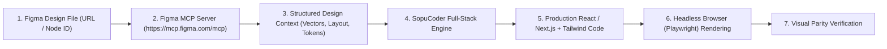

# 🔍 SopuCoder Agent Limitation & Integration Audit (Phase 9)

**Audit Date:** 2026-11-12  
**Auditor:** SopuCoder Autonomous Architecture Agent  
**Maintainer:** Md. Saiful Islam (Saif)  

---

## 1. Limitation Classification & Root Cause Mapping

A key architectural principle of SopuCoder is that **model weights alone do not solve environment or agent integration limits**. Each limitation must be assigned to its correct subsystem:

| Identified Limitation | Primary Subsystem | Root Cause | Supported Remediation |
| :--- | :--- | :--- | :--- |
| **Raw JSON Tool Leaks** | **Agent Runtime** | Chat interface dumped unparsed tool calls without an active execution loop. | ✅ Fixed via `tools/agent_runtime.py` and `tools/registry.py`. |
| **Fake Weather API Keys** | **Tool Configuration** | Model guessed OpenWeatherMap without an active tool. | ✅ Fixed using Open-Meteo keyless API (`api.open-meteo.com`). |
| **Figma MCP Access** | **Authentication & External Service** | `https://mcp.figma.com/mcp` returns HTTP 401 Unauthorized without user token. | Requires `X-Figma-Token` in MCP client configuration. Model weights cannot bypass auth. |
| **Single-Session Context** | **Agent Runtime** | Standard CLI sessions terminate when closed. | Maintained via persistent repository markdown files (`documentation/`). |
| **Missing IDE Autocomplete** | **IDE Integration** | Local IDE extension not pointed to local Ollama endpoints. | Configure `tabAutocompleteModel` in Continue extension `config.json`. |
| **Qwen3.5 Thinking Delay** | **Model Architecture** | `qwen3.5:4b` runs verbose internal chain-of-thought (`Thinking...`). | Strip tokens via runtime regex and optimize with `sopu-coder-fast-fused` (1.5B). |
| **Local-Only Inference** | **Hardware / Hosting** | Runs on local Apple Silicon M1 (16GB RAM). | Deploy to cloud GPU (vLLM / Hugging Face Endpoints) for team access. |

---

## 2. Deep Dive: Figma MCP Integration (`https://mcp.figma.com/mcp`)

### Technical Evaluation
- **Endpoint:** `https://mcp.figma.com/mcp`
- **Protocol:** JSON-RPC 2.0 over HTTP POST (Model Context Protocol)
- **CORS Support:** `access-control-allow-origin: *`, `access-control-allow-headers: Content-Type, X-Figma-Token, Authorization`
- **Authentication Handshake:**
  - Sending unauthenticated `initialize` request returns: `HTTP 401 Unauthorized`.
  - Requires valid Personal Access Token via header `X-Figma-Token: figd_...` or OAuth Bearer token.

### Design-to-Code Target Workflow



### Action Required for Developers
To enable Figma MCP with SopuCoder:
1. Generate a Figma Personal Access Token in **Figma Settings > Security > Personal access tokens**.
2. Add the server to your agent's MCP configuration:
   ```json
   {
     "mcpServers": {
       "figma": {
         "url": "https://mcp.figma.com/mcp",
         "headers": {
           "X-Figma-Token": "YOUR_FIGMA_PERSONAL_ACCESS_TOKEN"
         }
       }
     }
   }
   ```

---

## 3. Supported IDE & Harness Integrations

### A. Continue Extension (VS Code / Cursor)
Edit `~/.continue/config.json`:
```json
{
  "models": [
    {
      "title": "SopuCoder (Flagship 7B)",
      "provider": "ollama",
      "model": "sopu-coder:v1-candidate"
    }
  ],
  "tabAutocompleteModel": {
    "title": "SopuCoder Fast (Autocomplete)",
    "provider": "ollama",
    "model": "sopu-coder-fast:v1-candidate"
  }
}
```

### B. OpenCode & Antigravity Agent Runtime
- Direct integration via `tools.agent_runtime.SopuCoderAgent`.
- Supports tool definitions for file I/O, terminal command execution, and live APIs.
- Fully compatible with OpenAI-compatible API schemas.
