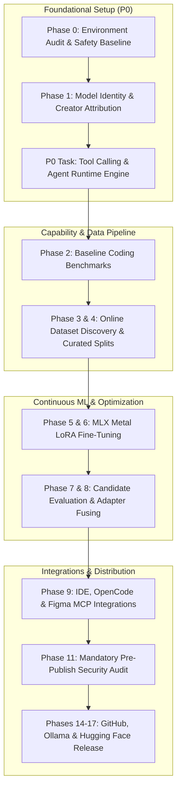

# 🚀 SopuCoder Master Execution Plan

**Author:** SopuCoder Engineering Team  
**Creator & Maintainer:** Md. Saiful Islam (Saif)  
**Hardware Baseline:** Apple Silicon M1 (16GB RAM, macOS)  
**Models:** SopuCoder (7B) & SopuCoder Fast (4B / 1.5B)  

---

## 🧭 Executive Architecture & Phase Mapping

---

## 📋 Comprehensive Phase Breakdown

### Phase 0: Environment Discovery & Safety Baseline
- [x] Inspect repository root, git remote, hardware resources (16GB RAM M1).
- [ ] Generate comprehensive documentation audit:
  - `documentation/PROJECT_AUDIT.md`
  - `documentation/PROJECT_CONTEXT.md`
  - `documentation/AUTOMATION_STATUS.md`
  - `documentation/NEXT_ACTIONS.md`

### Phase 1: Model Identity & Creator Attribution
- [ ] Update `sopu-coder/Modelfile` and `sopu-coder-fast/Modelfile` SYSTEM instructions:
  - **Creator:** Md. Saiful Islam (Saif)
  - **Foundation:** Alibaba Cloud / Qwen Team (Qwen2.5-Coder 7B and Qwen3.5 4B)
  - Transparent attribution when asked "Who created you?", "Are you Qwen?".
- [ ] Rebuild models in Ollama (`sopu-coder:v1-candidate`, `sopu-coder-fast:v1-candidate`).
- [ ] Execute automated identity test queries.

### P0 Priority: Fix Tool Calling & External API Integration Loop
- **Problem Statement:** Model returns raw unexecuted JSON (`webfetch` with invalid OpenWeatherMap API key placeholder) when asked questions requiring live information (e.g. "What is the weather today in Dhaka?").
- **Root Cause:** Absence of an active client/runtime dispatch loop for Ollama tool calling, and lack of keyless live endpoints (Open-Meteo).
- [ ] Implement `tools/agent_runtime.py`:
  - Native Ollama `/api/chat` tool calling integration with structured tool definitions.
  - Implement `get_current_weather` using **Open-Meteo API** (zero API keys required, geocoding for Dhaka & worldwide coordinates).
  - Implement safe `web_fetch` with validation and security restrictions.
  - Graceful fallback handler for unregistered or unavailable tools (no raw JSON leakage or fake API keys).
- [ ] Add comprehensive test suite in `tests/test_tool_calling.py`:
  - Test 1: Successful weather execution for Dhaka end-to-end.
  - Test 2: Handling unavailable tools without leaking JSON.
  - Test 3: API failure and timeout recovery.
  - Test 4: Latency & streaming overhead comparison.
- [ ] Run live end-to-end test on "What is the weather today in Dhaka?".

### Phase 2: Coding Capability Baseline
- [ ] Run benchmark evaluation matrix across 18 software domains (TypeScript, Next.js, Python, PHP, Yii2, WordPress, Three.js, GSAP, SaaS).
- [ ] Generate `documentation/BASELINE_BENCHMARKS.md` and `documentation/CAPABILITY_MATRIX.md`.

### Phases 3 & 4: Dataset Discovery, Cleaning & Versioning
- [ ] Maintain curated dataset registry in `datasets/DATASET_SOURCE_REGISTRY.md`.
- [ ] Expand validated samples across interactive frontends (Three.js/GSAP) and full-stack SaaS.
- [ ] Maintain strict data isolation against benchmark tests.

### Phases 5 to 8: Continuous Training, Evaluation & Optimization
- [ ] MLX LoRA training pipeline on Apple Silicon Metal.
- [ ] Evaluate candidate weights with strict promotion gates (no regression, no looping).
- [ ] Fuse adapters into standalone weights when promotion criteria pass.

### Phase 9: Agent Integrations (IDE & Figma MCP)
- [ ] Document and configure integration with Continue (VS Code / Cursor) and OpenCode.
- [ ] Investigate and test official Figma MCP (`https://mcp.figma.com/mcp`) design-to-code flow.
- [ ] Create `documentation/AGENT_LIMITATION_AUDIT.md`.

### Phases 10 to 18: Security Audit & Multi-Platform Release Pipeline
- [ ] Implement `scripts/pre_publish_audit.py` (explicit allowlist, zero exposed tokens).
- [ ] Automated publishing to GitHub, Ollama Registry, and Hugging Face Hub.
- [ ] Maintain rollback safety and immutable version tags.
