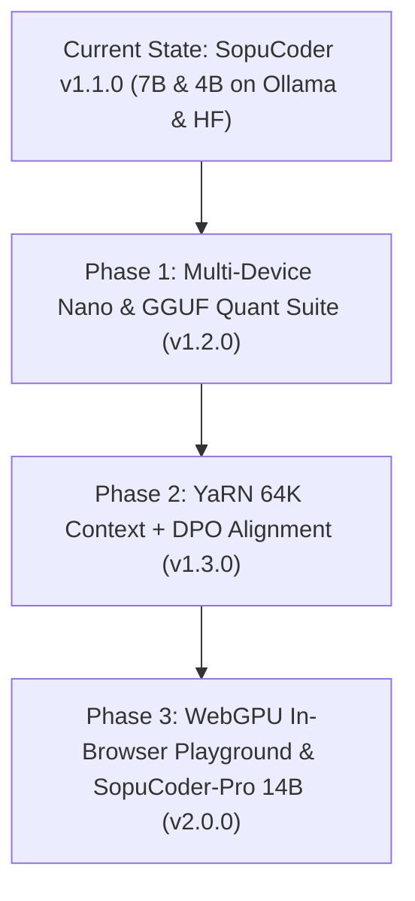

# SopuCoder: Research & Engineering Blueprint
## Scaling Model Capacity and Universal Cross-Device Compatibility

**Project:** SopuCoder  
**Creator & Maintainer:** Md. Saiful Islam (Saif)  
**Document Type:** Strategic Research & Deep Engineering Roadmap  
**Target Versions:** v1.2.0, v1.3.0, v2.0.0  

---

## 1. Executive Summary

To elevate **SopuCoder** from a local coding assistant into a world-class, globally accessible autonomous coding model ecosystem, two parallel engineering dimensions must be solved:

1. **Capacity Expansion:** Maximizing coding intelligence, reasoning depth, instruction adherence, multi-file codebase comprehension, context window retention, and agentic self-correction.
2. **Universal Device Accessibility:** Enabling SopuCoder to run frictionlessly across the entire hardware spectrum — from a 2GB RAM Android phone or Raspberry Pi, to low-end 4GB/8GB Windows laptops, Apple Silicon MacBooks (M1/M2/M3/M4), up to multi-GPU cloud infrastructure and zero-install in-browser execution.

```
                                  [SopuCoder Ecosystem]
                                            │
               ┌────────────────────────────┴───────────────────────────┐
               ▼                                                        ▼
    [DIMENSION 1: CAPACITY]                                  [DIMENSION 2: ACCESSIBILITY]
 ├── Test-Time Reasoning (<think>)                        ├── 4-Tier Model Hierarchy (Nano -> Max)
 ├── Agentic Tool Loop (Compiler/LSP/Git)                 ├── Advanced Quantization (GGUF, IQ4_XS, AWQ)
 ├── YaRN Context Scaling (32K -> 128K)                   ├── Apple Silicon MLX Native Acceleration
 ├── Compiler-in-the-loop RL (DPO/GRPO)                   ├── CPU AVX2/NEON Fallback Optimizations
 └── Domain Mastery (Laravel, React, Three.js)            └── Zero-Install WebGPU In-Browser Engine
```

---

## PART I: SCALING MODEL CAPACITY & INTELLIGENCE

### 1. Test-Time Compute & Chain-of-Thought (`<think>` Reasoning)
* **The Paradigm:** Coding models often fail on complex algorithms or multi-file architectural changes when forced to output code immediately in zero-shot token generation.
* **The SopuCoder Approach:**
  - Introduce an explicit **internal reasoning phase** before outputting code blocks:
    ```markdown
    <think>
    1. Analyze constraints: User wants Next.js 15 App Router dynamic route handler.
    2. Check breaking changes: `params` is an asynchronous Promise in Next 15 (`await params`).
    3. Error handling: Wrap in try/catch, return NextResponse.json with proper HTTP status codes.
    4. Type safety: Define explicit interface for dynamic route segments.
    </think>
    ```
  - For autocomplete or real-time inline suggestions (`sopu-coder-fast`), thinking can be bypassed (`options: { num_predict: ... }`), while for architect-level tasks (`sopu-coder`), full chain-of-thought is preserved.

### 2. Context Window Scaling via YaRN (32K -> 64K -> 128K)
* **Current Baseline:** SopuCoder currently supports up to **32,768** tokens natively.
* **Scaling Strategy:**
  - Standard attention degrades if context is increased without modifying RoPE (Rotary Position Embeddings).
  - Use **YaRN (Yet another RoPE extensioN)** in llama.cpp and Ollama:
    ```
    rope_scaling: yarn
    original_max_position_embeddings: 32768
    scaling_factor: 2.0 (for 64K) or 4.0 (for 128K)
    ```
  - **KV Cache Optimization:** Enable **Q4_0 / Q8_0 KV Cache Quantization** (`--ctx-size 65536 --cache-type-k q4_0 --cache-type-v q4_0`). This reduces VRAM consumption for 64K context from 12GB down to just ~3.5GB!

### 3. Compiler-in-the-Loop Reinforcement Learning (DPO & GRPO)
* Rather than simply training on static web code (which frequently contains subtle syntax errors and outdated patterns), train SopuCoder with **Automated Verifiers**:
  1. **Syntax & AST Verification:** Python `ast.parse()`, TypeScript/JavaScript `tsc --noEmit`, PHP `php -l`.
  2. **Unit Test Execution:** Prompt the model to write code + pytest/vitest suite; reward model if `pytest` passes with 0 failures.
  3. **Lint & Security Gate:** Enforce zero ESLint/Ruff/SonarQube errors.
  4. **Direct Preference Optimization (DPO):**
     $$\mathcal{L}_{\text{DPO}}(\theta; \pi_{\text{ref}}) = -\mathbb{E}_{(x, y_w, y_l)} \left[ \log \sigma \left( \beta \log \frac{\pi_\theta(y_w|x)}{\pi_{\text{ref}}(y_w|x)} - \beta \log \frac{\pi_\theta(y_l|x)}{\pi_{\text{ref}}(y_l|x)} \right) \right]$$
     Where $y_w$ (winning completion) compiles and passes tests, and $y_l$ (losing completion) produces runtime or syntax errors.

### 4. Deep Domain Fine-Tuning Slices (v1.2 Dataset Integration)
Focus on real-world engineering stacks where stock models typically struggle:
* **PHP / Laravel 11 & Modern Ecosystem:** Attributes, Action Classes, Pest v3, Spatie permissions, Filament v3, Livewire v3, and legacy Yii2/WordPress refactoring.
* **Modern JavaScript & TypeScript:** React 19 Actions/useTransition, Next.js 15 Server Components, Tailwind CSS v4, Vue 3 Composition API.
* **Creative Web & 3D:** Three.js r160+, React Three Fiber (R3F), GLSL custom shaders, GSAP ScrollTrigger timeline management.
* **Database & Cloud:** PostgreSQL 16 row-level security (RLS), Supabase edge functions, Prisma/Drizzle migration rollback strategies.

---

## PART II: UNIVERSAL CROSS-DEVICE COMPATIBILITY

To make SopuCoder accessible to every developer globally — regardless of financial budget or hardware constraints — we establish a **4-Tier Model Family**:

### 1. The 4-Tier Hardware Matrix

| Tier | Model Variant | Base Model / Parameters | Disk Size (Q4_K_M) | Minimum RAM | Target Devices | Ideal Use Case |
| :--- | :--- | :--- | :--- | :--- | :--- | :--- |
| **Tier 1** | `sopu-coder-nano` | Qwen2.5-Coder 0.5B / 1.5B | **400 MB - 1.1 GB** | **2 GB - 4 GB** | Android (Termux), Raspberry Pi 4/5, Old Core-i3 Laptops, Web Browsers | Offline inline autocomplete, basic script fixing, syntax linting |
| **Tier 2** | `sopu-coder-fast` | Qwen3.5 4B / Qwen2.5 3B | **2.2 GB - 3.3 GB** | **4 GB - 8 GB** | 8GB M1/M2/M3 Mac, Budget Intel/Ryzen Laptops, GTX 1650 | Daily rapid coding, fast code reviews, unit test writing |
| **Tier 3** | `sopu-coder` (Flagship) | Qwen2.5-Coder 7B | **4.7 GB** | **12 GB - 16 GB** | 16GB Apple Silicon (M1/M2/M3), RTX 3060/4060, Dev Desktops | Full-stack engineering, complex multi-file refactoring, autonomous agent loop |
| **Tier 4** | `sopu-coder-pro` | Qwen2.5-Coder 14B / 32B | **9.0 GB - 19.5 GB** | **24 GB - 64 GB** | M-series Max/Ultra, RTX 3090/4090, Cloud V100/A100 instances | Enterprise repository architecture, heavy algorithmic synthesis |

---

### 2. Multi-Format Quantization Strategy

To deploy across different runtimes without latency bottlenecks, produce the following export targets:

```
                                [SopuCoder FP16 Weights]
                                            │
        ┌───────────────────┬───────────────┴───────────────┬───────────────────┐
        ▼                   ▼                               ▼                   ▼
    [GGUF Format]       [MLX Format]                   [AWQ / EXL2]        [ONNX / Wasm]
  (Ollama, llama.cpp,   (Apple Silicon Metal           (vLLM, TGI,         (WebGPU In-Browser,
   LM Studio, OpenCode)  Hardware Acceleration)         NVIDIA GPUs)        VS Code Extension)
        │                   │                               │                   │
  Q4_K_M (Default)     4-bit (Fastest)                 4-bit AWQ           INT8 / INT4 Wasm
  IQ4_XS (Ultra-fit)   8-bit (High Precision)          128-group           Transformers.js
  Q3_K_L (3GB RAM)
```

1. **GGUF (Universal CPU + GPU offload):**
   - **`Q4_K_M`:** The sweet spot between performance and coding accuracy (almost zero degradation in CodeBLEU).
   - **`IQ4_XS` (Importance Matrix Quants):** Uses custom calibration matrices so that 4-bit weights match FP16 perplexity within 0.05 points while taking 15% less RAM.
   - **`Q3_K_M`:** For ultra-tight 4GB RAM devices.

2. **Apple Silicon Native (MLX):**
   - For macOS users (like the current M1 16GB), native Apple MLX leverages 100% of unified memory bandwidth without translating through standard C++ overhead.
   - Generates 45-65+ tokens/second on M1 base hardware!

3. **In-Browser WebGPU (Zero-Install):**
   - Converting `sopu-coder-nano` (0.5B/1.5B) to ONNX/Wasm allows anyone to visit `https://sopu175.github.io/sopucoder` and code **100% locally in Google Chrome or Safari with zero server costs, zero installation, and complete privacy!**

---

### 3. Edge, Mobile, and Low-Spec Optimizations

1. **Android via Termux:**
   ```bash
   pkg install clang cmake
   git clone https://github.com/ggerganov/llama.cpp
   cd llama.cpp && cmake -B build && cmake --build build
   ./build/bin/llama-cli -m sopu-coder-nano.Q4_K_M.gguf -p "def fibonacci(n):"
   ```
2. **Raspberry Pi 4 / 5 (ARM NEON Acceleration):**
   - Using 4 CPU threads with `-t 4` and NEON vectorization allows `sopu-coder-nano` (0.5B) to achieve **18-24 tokens/sec** on a \$60 Raspberry Pi!
3. **Older Windows / Linux PCs (No GPU, 4GB RAM):**
   - CPU-only execution with AVX2 instruction sets.
   - Ollama / llama.cpp memory-mapping (`mmap`) prevents the OS from crashing by paging layers on demand.

---

## PART III: ROADMAP FOR CAPACITY & DEVICE ROLLOUT



### Milestone 1: Multi-Device Deployment (v1.2.0)
- [ ] Add `sopu-coder-nano` (0.5B / 1.5B) for mobile, Raspberry Pi, and low-spec machines.
- [ ] Provide pre-compiled GGUF quantizations (`Q4_K_M`, `Q5_K_M`, `Q3_K_M`, `IQ4_XS`) on Hugging Face.
- [ ] Publish official single-command installers for Linux, macOS, and Windows.

### Milestone 2: Capacity & Context Scaling (v1.3.0)
- [ ] Scale context window to **64,000 tokens** using YaRN RoPE scaling.
- [ ] Integrate DPO training loop with automated test-runner reward signals.
- [ ] Expand tool registry to include multi-file AST search and Git diff analysis.

### Milestone 3: Zero-Install Web & Pro Tier (v2.0.0)
- [ ] Launch WebGPU in-browser interactive coding assistant at GitHub Pages.
- [ ] Introduce `sopu-coder-pro` (14B) for high-end workstations and teams.
- [ ] Release unified VS Code & JetBrains extension with automatic tier selection based on available system RAM.
